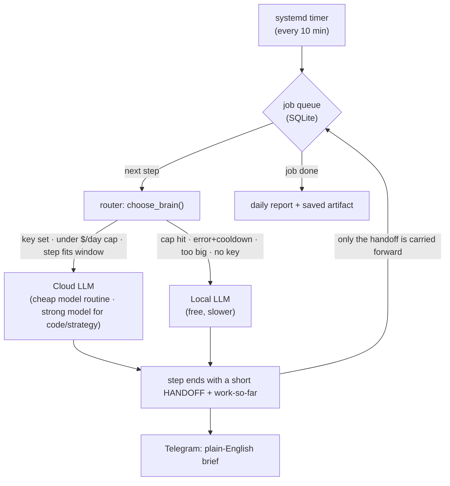

# Two-Brain Relay

A small autonomous task runner that makes a **paid cloud LLM** and a **free local LLM** take turns on the same long-running job, under a hard daily spend cap, without ever losing the thread.

It solves two problems that show up the moment you try to run an LLM on real multi-step work unattended:

1. **Context saturation.** A long task overflows the model's context window if you keep appending the whole history.
2. **Cost.** Doing every step on a frontier model is expensive; doing every step locally is slow and weaker.

The relay routes **each step** to the cheapest brain that can actually do it, and passes a compact **handoff** instead of the full transcript — so the context never saturates and either brain can continue where the other stopped.



## How a step is routed

Each step, `choose_brain()` asks, in order:

1. Is a cloud key present, is the model **not** in an error cooldown, and does the step **fit** the configured working window? **And** would running it keep **today's spend under the cap**?
   → **Cloud.** Cheap model for routine steps, strong model for code / deep reasoning / strategy.
2. Otherwise, is the local model reachable?
   → **Local**, for free.
3. Otherwise wait and retry on the next tick.

The daily cap resets at midnight, so work naturally flows back to the cloud model the next morning. No schedule decides the switch — budget, errors and step size do.

## The handoff protocol

Every step must end with:

```
## HANDOFF
<≤250 words: what's done, key findings, what remains, the exact next action>
## STATUS
CONTINUE | DONE
```

The next step receives **only** that handoff plus the work produced so far — never the full conversation. This keeps every request small and lets a different model (local or cloud) pick up mid-task seamlessly.

## Job types

| Kind | What it does |
|------|--------------|
| `think` | Long reasoning / research toward a goal; may read files under configured roots |
| `evaluate` | Scores every project under `~/Projects` and writes a report |
| `strategy` | Rethinks one project for commercial potential; can auto-chain from a `triage` ranking |
| `codefix` | Finds and fixes bugs in a git repo — **on a separate branch, in a git worktree, with tests run there** so your working tree is never touched |

## Safety guardrails

- **Hard daily budget.** Spend is tracked in a local ledger; a step that would exceed the cap is sent to the local model instead.
- **File-read allowlist + secret filter.** Reads are confined to configured roots, and anything that looks like a credential (`.env`, `*.key`, `*token*`, `*.pem`, databases…) is refused — it never reaches an API.
- **Code changes are proposals.** `codefix` applies diffs only on a `brain/job-<id>` branch and runs the tests there; you merge if you like the result.
- **Loop detection.** If a brain repeats itself, it is switched or the job is stopped — it can't spin forever.
- **Step ceiling** per job.

## Reporting & control (optional Telegram)

- A plain-English brief after each job: *Done / Found / Changed / Next step*.
- A daily digest with spend, work done, and the top next actions.
- Remote commands: `/status`, `/report`, `/pause`, `/resume`, `/cancel N`, `/think …`, `/strategy …`.

## Quickstart

```bash
# 1. config
cp relay.example.json relay.json          # edit the cap, models, roots

# 2. provide a cloud key via the OS keyring (never a file)
secret-tool store --label='API key: anthropic' service apikeys name anthropic

# 3. run once, or install the 10-minute timer
python3 relay.py add think "Summarize what this repo does"
python3 relay.py tick                     # run now
bash install.sh                           # or: run every 10 minutes
```

Point `ods_url` at any OpenAI-compatible local endpoint (llama.cpp, Ollama, LM Studio, vLLM…). Keys are read from the Secret Service keyring (`libsecret`), with an environment-variable fallback; nothing sensitive is stored in the repo.

## Design notes

- **One file, standard library only.** No framework, no SDK — just `urllib`, `sqlite3`, `subprocess`. Easy to audit, easy to run anywhere.
- **State is a tiny SQLite queue.** Jobs, steps, per-step cost and the carried-forward work all live in one local DB.
- **Model-agnostic.** The cloud side speaks the Anthropic Messages API; the local side speaks the OpenAI chat-completions API. Swap either without touching the logic.

## Documentation

- **[docs/CHANCO.md](docs/CHANCO.md)** — overview of CHANCO, a companion
  local-first AI "second brain" (personal retrieval memory, voice loop, email
  drafting, system dashboard). Its source lives elsewhere; this is a write-up of
  its design and the Linux engineering behind it.
- **[docs/BUILD_LOG.md](docs/BUILD_LOG.md)** — a stage-by-stage build log of
  that work: what was built, the bug that got in the way, and the lesson that
  fixed it (Wayland vs. X11, LiteLLM-as-gateway, priming Whisper, pinning client
  libraries, RAG with Qdrant).

## License

MIT — see [LICENSE](LICENSE).
